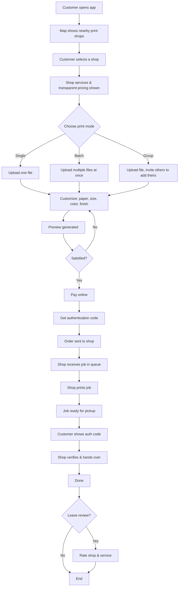

# PrintLoop — Printing Flow



## Simplified linear version

```
Open App → Map → Select Shop → See Services & Pricing
    → Choose Mode (Single/Batch/Group) → Upload File(s)
    → Customize → Preview → Pay → Get Auth Code
    → Order Sent → Shop Prints → Pickup + Verify → Review
```

## Print Mode Options

| Mode | Use Case |
|------|----------|
| Single | One file, one-off print job |
| Batch | Multiple files in one order |
| Group | One starter file, others contribute |
